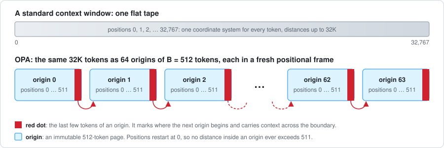
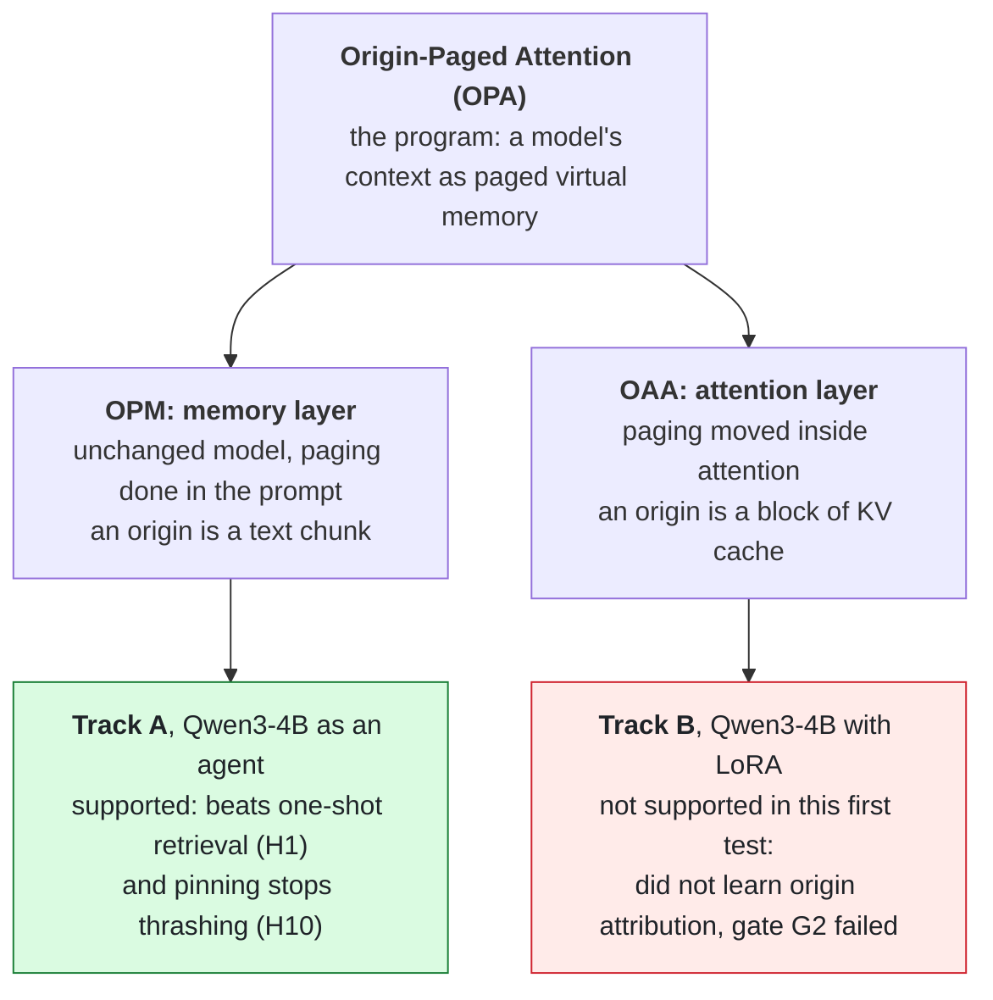
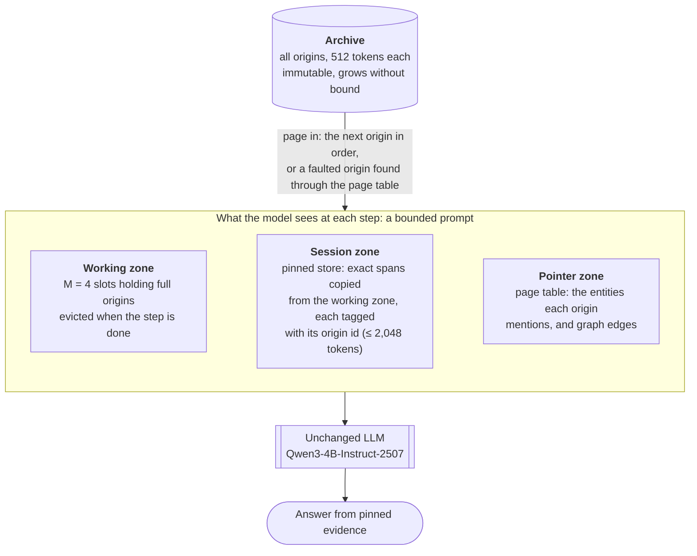
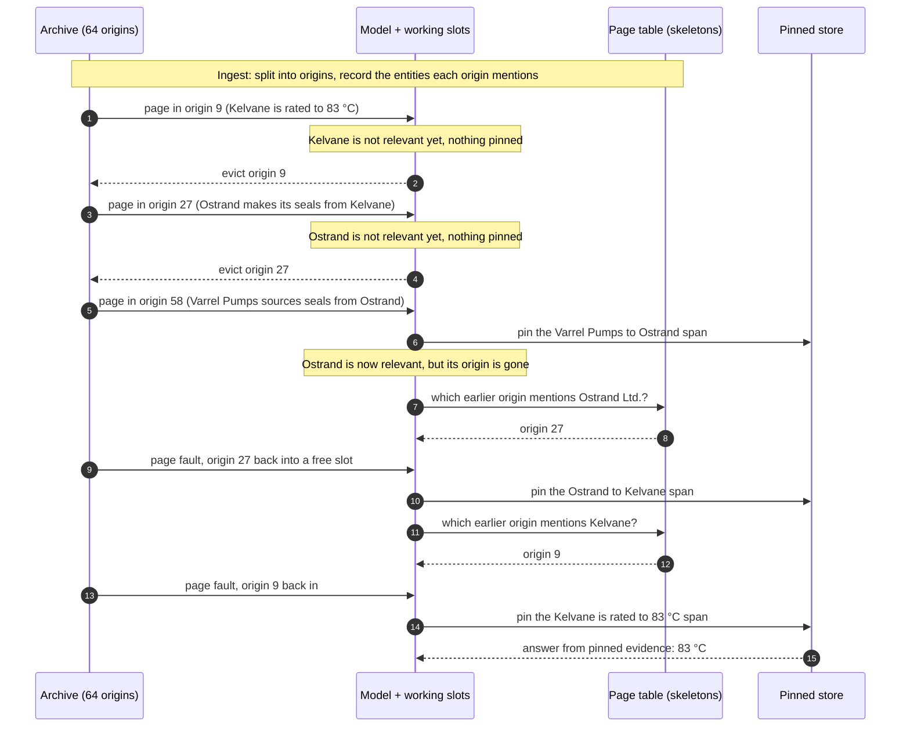
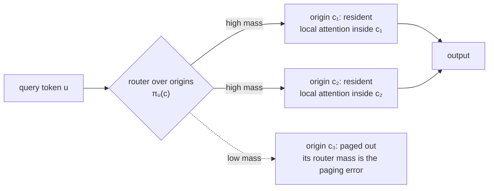
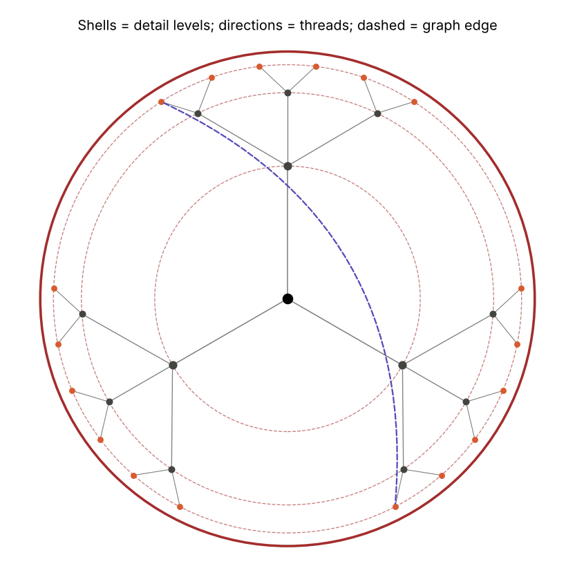
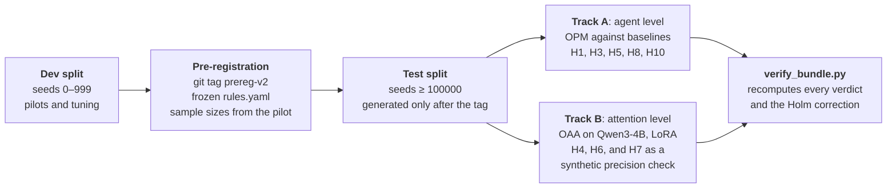
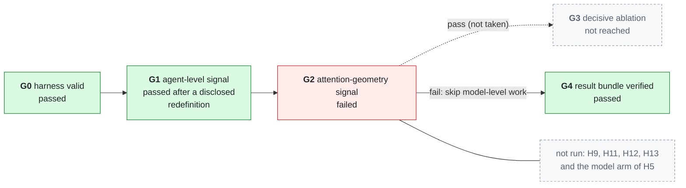
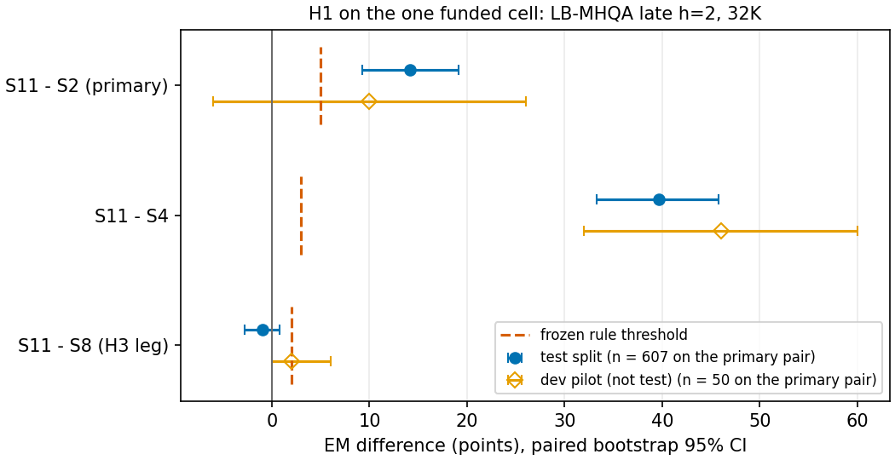
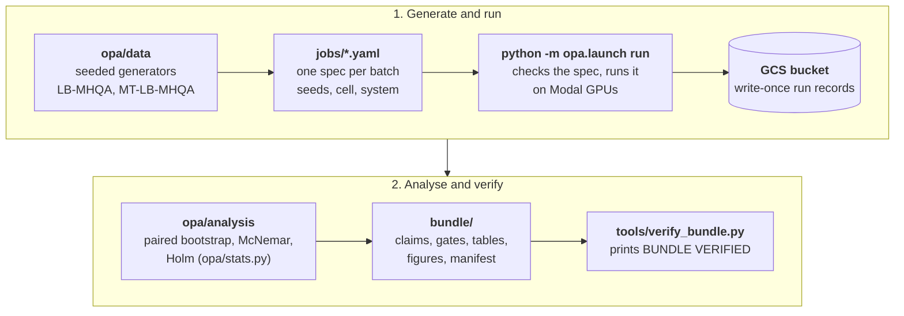

# Origin-Paged Memory: code, pre-registration and verified results

[](https://doi.org/10.5281/zenodo.24123974)

This repository holds the code, job specifications, pre-registration, frozen verdict rules and the verified final result bundle behind the preprint *Origin-Paged Memory: Treating Language-Model Context as Virtual Memory* (Aaditya Rajgor, 2026).

**Preprint:** link to follow.

**Contents:** [OPA in one picture](#opa-in-one-picture) · [What OPA, OPM and OAA are](#what-opa-opm-and-oaa-are) · [How OPM answers a question](#how-opm-answers-a-question) · [How OAA changes attention](#how-oaa-changes-attention) · [What was tested](#what-was-tested) · [Headline results](#headline-results) · [How to reproduce](#how-to-reproduce) · [Folder map](#folder-map)

## OPA in one picture

An operating system runs programs far larger than its physical memory: memory is cut into pages, a few pages sit in RAM, the rest wait on disk, and a page table says where everything is. When a program touches a page that is not in RAM, a *page fault* brings it back. Origin-Paged Attention applies the same idea to a language model's context.

<p align="center">
  
</p>

| Operating system | OPA | Setting in this study |
| --- | --- | --- |
| Page | **Origin**: an immutable chunk of the archive | B = 512 tokens |
| Disk | **Archive**: every origin ever written | a 32K-token document (64 origins) |
| Physical memory frames | **Working slots**: origins whose full text (or KV cache) is loaded | M = 4 slots |
| Registers | **Pinned store**: exact evidence copied verbatim, each span tagged with its origin | 2,048 tokens |
| Page table | **Skeleton** (the entities each origin mentions) and a **graph page table** of links between origins | built once, when the archive is read in |
| Page fault | an entity becomes relevant after its origin was evicted: look it up, page that origin back in | Algorithm 3 in the design paper |
| Thrashing | a step needs more origins at once than there are slots | tested as H10 |

## What OPA, OPM and OAA are

**Origin-Paged Attention (OPA)** is the research program as a whole. It treats a language model's context like virtual memory in an operating system: the archive is split into fixed-size chunks called *origins* (512 tokens here), and the last few tokens of each origin, its *red dot*, mark where the next origin begins and carry context across the boundary. The program has two layers, a memory layer (OPM) and an attention layer (OAA). The earlier design and theory draft is in [`docs/paper_v2.md`](docs/paper_v2.md).

**Origin-Paged Memory (OPM)** is the memory layer, and it works with an unchanged model. It reads origins in order with a few working slots (M = 4), copies exact evidence into a small pinned store (2,048 tokens), and keeps a page table that lists the entities each origin mentions (its *skeleton*). When an entity becomes relevant only after its origin has been evicted, OPM looks it up in the page table and pages that origin back in: a *page fault*. This is the "fold-left with skeleton and graph faults" system, labelled `S11` in the code and results (`S8` is the same without links between origins).

**Origin-Anchored Attention (OAA)** is the attention layer, which would move paging inside the model. Each origin restarts its rotary positions at zero (a fresh positional frame), and an address vector for each origin, placed in a hyperbolic (Poincaré-ball) space, enters the attention logit through a content-router term and a structural distance penalty. The paper proves that this attention factors exactly into a choice of origin times ordinary attention within it, so the error caused by paging equals the attention mass that was paged out. The Track B code in [`opa/trackb/`](opa/trackb/) implements it on Qwen3-4B (arm `V3`, against standard attention `B1`).



## How OPM answers a question

OPM keeps what the model sees bounded. At every step the prompt holds three zones, however long the archive is:



The hard case is a **late-binding** multi-hop question: the fact you need is written *before* anything tells you it matters. Reading in order, OPM has already evicted it by the time it becomes relevant, and a page fault brings it back. An illustrative item in the style of the synthetic LB-MHQA benchmark (field format in [`opa/data/SCHEMA.md`](opa/data/SCHEMA.md)), with two late-bound hops:

> **Question:** What temperature is the material in Varrel Pumps' seals rated to? **Answer:** 83 °C
>
> - origin 9: *"Kelvane is rated to 83 °C."*
> - origin 27: *"Ostrand Ltd. makes its seals from Kelvane."*
> - origin 58: *"Varrel Pumps sources seals from Ostrand Ltd."*
>
> The other 61 origins are filler text with some distractor facts. Read in order, the answer (origin 9) comes before the fact that makes it relevant (origin 58).



A one-shot retriever (`S2`) has to find all three facts from the question alone, and the question names only Varrel Pumps. `S8` finds the earlier origin through the skeleton; `S11` can also follow graph edges between origins. The full algorithm, with its fixpoint over newly revealed entities, is Algorithm 3 in [`docs/paper_v2.md`](docs/paper_v2.md), and the Track A implementation is in [`opa/tracks/track_a/systems.py`](opa/tracks/track_a/systems.py).

## How OAA changes attention

OAA moves the same paging into the attention layer. For a query token *u* in origin *c<sub>u</sub>* and a key token *v* in origin *c<sub>v</sub>* at offsets ℓ<sub>u</sub> and ℓ<sub>v</sub>:

```math
s(u,v) \;=\; \underbrace{\frac{\big(R(\ell_u\omega)\,q_u\big)^{\top} R(\ell_v\omega)\,k_v}{\sqrt d}}_{\text{RoPE inside a fresh frame}} \;+\; \underbrace{r_u^{\top} A\, o(c_v)}_{\text{content router}} \;-\; \underbrace{\lambda\, d_{\mathbb H}\big(o(c_u),\, o(c_v)\big)}_{\text{structural penalty}}
```

The last two terms are the same for every key in an origin, so the softmax splits exactly into *which origin* times *which token inside it* (Theorem 6 in the design paper):

```math
a(u,v) \;=\; \underbrace{\pi_u(c_v)}_{\text{router mass of origin } c_v} \cdot \underbrace{\alpha_u(v \mid c_v)}_{\text{ordinary attention inside it}}
```



So the router mass of an origin is both its share of attention and its claim on GPU memory: paging out a set of origins changes the attention distribution by exactly their total router mass (Corollary 6.2). The origin addresses *o(c)* live in a Poincaré ball: radius is level of detail, direction is the thread, and dashed graph edges link distant branches that the geometry cannot bring close.

<p align="center">
  
</p>

In this first test the learned version (`V3`) did not learn to attribute facts to their origin within its 600 training steps (own-origin attention mass about 0.32 against a 0.90 gate), so everything that depends on a working attention layer was not run. See [Headline results](#headline-results).

## What was tested

Thirteen hypotheses (H1–H13) were written down with frozen verdict rules *before* any test data existed. Test items are generated from seeds that the generators refuse to use until the pre-registration tag exists, and an independent verifier recomputes every verdict from the frozen rules.



Gates decided which work was allowed to run next. A failed gate is a result, not a stop: the work behind it is recorded as `not_run_gate_failed`.



The G1 redefinition, and the original failed decision, are disclosed in [`bundle/PAPER_INPUT.md`](bundle/PAPER_INPUT.md) and kept in [`bundle/gates/history/`](bundle/gates/history/).

The systems that appear in the results (the full list S1–S18 is in [`docs/protocol_v2.md`](docs/protocol_v2.md), Section 3.5):

| ID | System | Role |
| --- | --- | --- |
| `S2` | One-shot top-k retrieval (BM25 + dense hybrid, k tuned on dev) | main baseline for H1 |
| `S4` | ReadAgent-style gist memory with page lookup | closest prior agent design |
| `S8` | OPM: fold-left with skeleton page faults | the v1 system |
| `S11` | `S8` + graph page-table faults | **the OPM system** (H1, H3) |
| `S12`, `S14`, `S15` | `S11` + shell descent with hyperbolic, Euclidean or exact-tree distance (arms A2, A1, A3) | geometry ablation (H5) |
| `B1`, `V0`, `V3` | standard attention with LoRA; fresh frames only, no training; OAA with LoRA | attention layer (H4) |

The subject model in every track is `Qwen/Qwen3-4B-Instruct-2507` at temperature 0; the Track A systems also use the `microsoft/harrier-oss-v1-0.6b` embedder. Both revisions are pinned in [`config/project.yaml`](config/project.yaml).

## Headline results

13 hypotheses (H1-H13) were pre-registered (tag `prereg-v2`) with verdict rules fixed before any test data existed, then tested on `Qwen/Qwen3-4B-Instruct-2507`. An independent verifier recomputes every verdict from the frozen rules.

- **OPM beats one-shot retrieval.** On synthetic late-binding multi-hop questions (LB-MHQA, late h = 2, 32K tokens, n = 607), OPM (`S11`) answered 76.6% exactly, against 62.4% for one-shot retrieval (`S2`): **+14.2 EM points** (95% CI 9.2 to 19.1, Holm-adjusted p < 0.000001). It also beat a gist-memory agent (`S4`, 37.3%) by 39.6 points (95% CI 33.2 to 45.8, n = 391). H1: supported.
- **Pinning prevents thrashing** (H10: supported; 2.54 fewer repeated page-ins per item, 95% CI 2.27 to 2.83).
- **Several distinctive ingredients added nothing measurable:** the graph of links between origins, hyperbolic rather than Euclidean distances, and the red-dot prefix.
- **The attention layer did not learn in this first test.** A short fine-tuning run (600 steps, stopped by the pre-registered stopping rule) did not teach OAA to attribute facts to their origin: source attribution 31.2% for OAA against 99.6% for standard attention, and an own-origin attention mass of about 0.32 against a 0.90 gate threshold. Gate G2 therefore failed, and the tests that depend on a working attention layer (H9, H11, H12, H13) were not run, as the pre-registration requires.

Exact match by system on the H1 cell (LB-MHQA, late h = 2, 32K tokens, test split; from [`bundle/tables/p2_contrasts_test.csv`](bundle/tables/p2_contrasts_test.csv)):

| System | Exact match | Items |
| --- | ---: | ---: |
| `S11` OPM (skeleton + graph faults) | 76.6% | 607 |
| `S8` OPM without graph edges | 77.6% | 607 |
| `S2` one-shot retrieval | 62.4% | 607 |
| `S4` gist memory | 37.3% | 391 (`S11` scores 77.0% on these items) |

<p align="center">
  
</p>

Every hypothesis, with the verdict its frozen rule gives:

| | Hypothesis | Layer | Verdict |
| --- | --- | --- | --- |
| H1 | OPM (fold-left with skeleton and graph faults) beats one-shot retrieval on late-binding multi-hop questions | memory | ✅ supported |
| H2 | Extractive session state keeps turn-1 constraints through 50 turns | memory | ⚪ inconclusive |
| H3 | Measured coverage predicts success, and graph edges add recall beyond skeletons | memory | ❌ refuted (`S11` − `S8` = −1.0 points) |
| H4 | Fresh frames alone alias origins; the origin vector repairs it and adds provenance | attention | ❌ refuted (fresh-frame aliasing confirmed; the repair was not learned) |
| H5 | Hyperbolic distance beats Euclidean distance on the same tree | both | ⚪ inconclusive (agent arm +0.4 points, CI −2.0 to 3.2; model arm not run) |
| H6 | Red-dot prefix and graph-parent co-encoding close most of the contextual-dependence gap | attention | ❌ refuted (best remedy recovers 95%, but the red-dot prefix adds nothing over naive reuse) |
| H7 | Global coordinates lose precision at the predicted depths; re-anchored offsets do not | attention | ✅ supported (synthetic measurement) |
| H8 | Descent through shells matches flat routing with far fewer scores | memory | ✅ supported as non-inferiority, but both arms were at floor, so it says nothing about quality |
| H9 | Page-in by copying KV beats re-encoding above a measurable chunk size | systems | ⏸ not run (G2 failed) |
| H10 | Pinning prevents thrashing when a step needs more origins than slots | memory | ✅ supported |
| H11 | OAA keeps full-attention accuracy with at most a quarter of the KV cache resident | attention | ⏸ not run (G2 failed) |
| H12 | OAA makes fewer cross-thread mix-ups than standard attention | attention | ⏸ not run (G2 failed) |
| H13 | Re-using a saved page by copy keeps full-recompute accuracy at a fraction of the reload time | systems | ⏸ not run (G2 failed) |

In short: the memory layer is supported; moving it inside attention remains open. Every verdict, with its rule, estimate, CI and deviations, is in [`bundle/PAPER_INPUT.md`](bundle/PAPER_INPUT.md) and [`bundle/tables/final_verdicts.csv`](bundle/tables/final_verdicts.csv).

## How to reproduce

The experiments ran on [Modal](https://modal.com) GPUs (L4 by default, T4 for small jobs), with artifacts written write-once to a Google Cloud Storage bucket.



1. **Install** Python 3 and the dependencies: `pip install -r requirements.txt`.
2. **Configure** [`config/project.yaml`](config/project.yaml): replace `YOUR_GCP_PROJECT` and `gs://YOUR_BUCKET` with your own GCP project and bucket. Everything is written under `opa/` in that bucket.
3. **Set up Modal**: `modal setup`, then create a Modal secret named `opa-gcp` holding a service-account key that can create and read (not delete) objects in your bucket. An `opa-hf` Hugging Face secret is optional; all models used are ungated.
4. **Run the tests** (no GPU, no spend): `python -m pytest -q tests` and `python -m pytest -q tools/tests`.
5. **Re-run a job**: `python -m opa.launch run jobs/<job>.yaml`. The test-split jobs behind the verdicts are listed in [`jobs/interim/`](jobs/interim/); each run's seed and git SHA are recorded in its run id under [`bundle/runs/`](bundle/runs/). Each job spec carries a cost cap (`max_usd`), and `opa.launch` checks spending against a `budget/approvals.yaml` and `budget/ledger.csv` that you create for your own account (see [`opa/budget.py`](opa/budget.py)).
6. **Verify the bundle**: `python tools/verify_bundle.py bundle/ --no-git`. It recomputes every verdict and Holm p-value from [`prereg/rules.yaml`](prereg/rules.yaml), checks the claim, gate and test records against the schemas in [`bundle_spec/`](bundle_spec/), and checks every file hash in `bundle/manifest.json`. `--no-git` skips the checks against the original repository's `prereg-v2` tag, which is not part of this repository's history.

### What differs from the internal bundle

This is a public copy of the result bundle, with internal and account-specific material taken out:

- The budget records (approvals, ledger, prices, provider reconciliations) and the cost and planning tables are not included, so the verifier skips its budget check (D9) when `bundle/budget/` is absent. Rebuilding the bundle with `opa.analysis.final_bundle` needs those records and is not possible from this copy.
- The original bucket name is replaced with `YOUR_BUCKET` in the run records, two tables and two tests; a local file path is removed from the G4 gate record; the cost section is removed from `PAPER_INPUT.md`. The SHA-256 entries in `bundle/manifest.json` were updated for exactly these files.
- The `gs://` URIs in the run records point to run artifacts and datasets that are not public.
- Some records and code comments refer to the internal run plan (`PLAN_V3`) and run log (`state/...`), which are not released. The public design is the pre-registration in [`prereg/`](prereg/); every deviation from it is listed in [`bundle/deviations.md`](bundle/deviations.md).

## Folder map

| Path | What it holds |
|---|---|
| [`opa/`](opa/) | Harness code: data generators (`data/`), Track A agent-level memory systems (`tracks/`), Track B attention-level OAA arms and training (`trackb/`), analysis and bundle building (`analysis/`), statistics, scoring, budget and Modal launcher |
| [`jobs/`](jobs/) | Job specifications (YAML) for every run and the scripts that generate them |
| [`prereg/`](prereg/) | Pre-registration `prereg-v2.md`, frozen verdict rules `rules.yaml`, sample sizes, and registered deviations |
| [`bundle/`](bundle/) | Verified final result bundle: `PAPER_INPUT.md` (results summary), claims H1-H13, gates G0-G4, unit tests U1-U8, tables, figures, run records, deviations and `manifest.json` (file hashes) |
| [`bundle_spec/`](bundle_spec/) | JSON schemas for the claim, gate and unit-test records, used by the verifier |
| [`tools/`](tools/) | `verify_bundle.py`, the machine-checkable definition of done, and its tests |
| [`tests/`](tests/) | Tests for the harness |
| [`config/`](config/) | `project.yaml`: GCP placeholders, Modal settings, models and pinned revisions |
| [`docs/`](docs/) | Design paper draft v2, test protocol v2 and their figures; `docs/figures/readme/` holds the figures drawn for this README |
| `CITATION.cff`, `.zenodo.json` | Citation and archive metadata |

## Citation

See [`CITATION.cff`](CITATION.cff). To cite the work across versions, use the concept DOI [10.5281/zenodo.24123974](https://doi.org/10.5281/zenodo.24123974), which always resolves to the latest version. Version 1.0.0 is archived as [10.5281/zenodo.24123975](https://doi.org/10.5281/zenodo.24123975). Version 1.0.1 adds the README diagrams and changes no code, data or results.

## License

Apache License 2.0. See [`LICENSE`](LICENSE) and [`NOTICE`](NOTICE).
